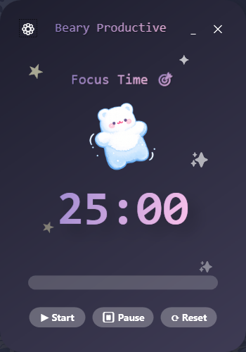
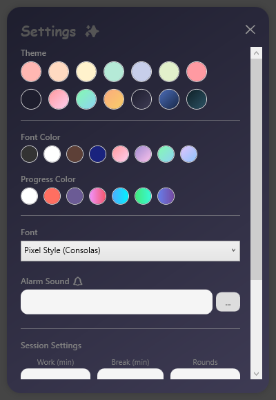
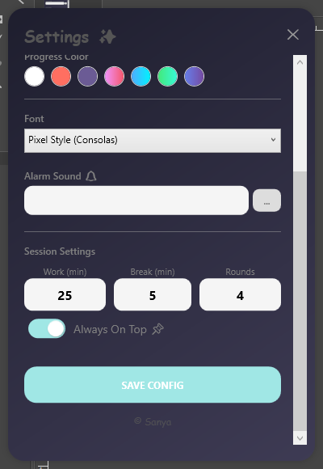
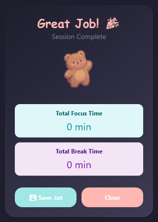

# 🐻 San Pomodoro Timer

   

A minimalist and **super cozy Pomodoro timer** for Windows. Accompanied by an animated bear companion, this app helps you stay focused while keeping the vibes relaxed and aesthetic.

Developed with ❤️ by **Sanya**.

---

## ✨ Features

* **🧸 Animated Companion:** A cute bear that floats and changes appearance based on your status (Brown = Focus / White = Break).
* **🎨 Fully Customizable:**
    * Beautiful **Pastel Themes** for the background.
    * Support for **Color Gradients** on text and progress bars.
    * Various font choices (including Comic Sans & handwritten styles).
* **📱 Mini-Mode (Widget):** Minimize the timer into a tiny, unobtrusive window at the bottom right of your screen to maintain focus.
* **🎵 Smart Audio:** Use your own custom MP3 files as an alarm or stick with the built-in default sound.
* **⏱️ Precise Logic:** The timer syncs with the system clock—it keeps running accurately even if the window is minimized or the PC lags.
* **💾 Auto-Save:** All settings (colors, durations, sounds) are saved automatically.
* **📊 Statistics:** View your session summary and export your work report as a `.txt` file.

---

## 📸 Screenshots

Here is a sneak peek of the application in action.

### The Focus Buddy 🐻

| **Main Window (Focus Mode)** |
|:---:|
|  |

### Customization ✨

| **Themes & Colors** | **Timer & Sound Settings** |
|:---:|:---:|
|  |  |

### Other Modes & Stats 📊

| **Mini-Widget Mode** | **Statistics & Breaks** |
|:---:|:---:|
|  |  |

---

## 🚀 Installation & Usage

### Prerequisites
* Windows 10 or 11
* .NET Framework 4.8 (usually pre-installed on modern Windows)

### For Developers
1.  Clone the repository:
    ```bash
    git clone [https://github.com/YOUR-USERNAME/SanPomodoroTimer.git](https://github.com/YOUR-USERNAME/SanPomodoroTimer.git)
    ```
2.  Open the solution file `PomodoroTimer.sln` in **Visual Studio**.
3.  Click **Start** (F5) to build and run the application.

---

## 🎮 Controls

* **▶ Start / ⏸ Pause:** Starts or pauses the current timer.
* **⟳ Reset:** Resets the timer to the beginning of the interval.
* **_ (Underscore):** Activates **Mini-Mode** (Widget in the bottom right corner).
* **⚙ (Gear Icon):** Opens the **Settings** menu (Colors, Durations, Sound).
* **Always On Top:** Can be enabled in the settings (📌).

---

## 🛠️ Technologies

* **Language:** C#
* **UI Framework:** WPF (Windows Presentation Foundation)
* **Design:** XAML (Custom Styles, Animations, Templates)

---

## 📝 License

This project is licensed under the MIT License. Feel free to fork it and make it your own!

---
*© Sanya - Created for a cozy workflow.*
